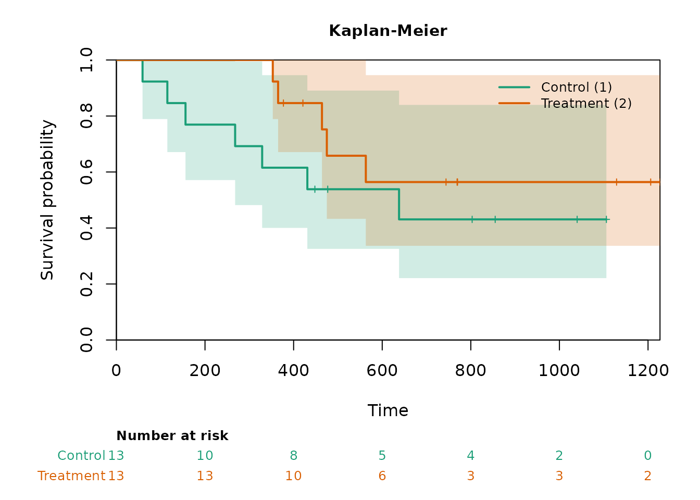

# Introduction to FastSurvival

## Overview

FastSurvival provides fast alternatives to the standard survival
analysis functions in the
[survival](https://cran.r-project.org/package=survival) package,
together with a simulation layer for designing and evaluating
time-to-event trials. Every function is designed for repeated evaluation
inside large simulation loops, where the iterative or object-building
overhead of the standard implementations becomes a bottleneck. Core
computations are implemented in C++ via Rcpp.

``` r

library(FastSurvival)
```

## Function families

The package has two families of functions. Collett (2014) gives the
methodological background of the standard methods they implement.

The estimation and testing functions operate on a single dataset and
return an S3 object with a
[`print()`](https://rdrr.io/r/base/print.html) method.
[`survfit_fast()`](https://gosukehommaEX.github.io/FastSurvival/reference/survfit_fast.md)
evaluates the Kaplan-Meier estimate at a single time point.
[`survdiff_fast()`](https://gosukehommaEX.github.io/FastSurvival/reference/survdiff_fast.md)
computes the log-rank test and its weighted and stratified variants.
[`coxph_fast()`](https://gosukehommaEX.github.io/FastSurvival/reference/coxph_fast.md)
returns a closed-form hazard ratio, the Pike-Halley Estimator.
[`rmst_fast()`](https://gosukehommaEX.github.io/FastSurvival/reference/rmst_fast.md)
returns the restricted mean survival time, and
[`wmst_fast()`](https://gosukehommaEX.github.io/FastSurvival/reference/wmst_fast.md)
the window mean survival time over an interval.
[`milestone_fast()`](https://gosukehommaEX.github.io/FastSurvival/reference/milestone_fast.md)
compares survival at a milestone timepoint, and
[`medsurv_fast()`](https://gosukehommaEX.github.io/FastSurvival/reference/medsurv_fast.md)
compares median survival times.
[`maxcombo_fast()`](https://gosukehommaEX.github.io/FastSurvival/reference/maxcombo_fast.md)
computes the max-combo test,
[`rmw_fast()`](https://gosukehommaEX.github.io/FastSurvival/reference/rmw_fast.md)
the robust modestly-weighted log-rank test, and
[`wkm_fast()`](https://gosukehommaEX.github.io/FastSurvival/reference/wkm_fast.md)
the weighted Kaplan-Meier (Pepe-Fleming) test.
[`ahsw_fast()`](https://gosukehommaEX.github.io/FastSurvival/reference/ahsw_fast.md)
computes the average hazard with survival weight, and
[`ahr_fast()`](https://gosukehommaEX.github.io/FastSurvival/reference/ahr_fast.md)
the Kalbfleisch-Prentice average hazard ratio.

The simulation functions support a full simulation study.
[`simdata_fast()`](https://gosukehommaEX.github.io/FastSurvival/reference/simdata_fast.md)
generates individual patient data for one-group, two-group, or multi-arm
trials.
[`cutoff_fast()`](https://gosukehommaEX.github.io/FastSurvival/reference/cutoff_fast.md)
determines the calendar time of every analysis look in every simulated
trial from combined event and calendar-time rules.
[`analysis_fast()`](https://gosukehommaEX.github.io/FastSurvival/reference/analysis_fast.md)
performs interim or sequential analyses of the simulated data at one or
more looks, and can compute any of the estimation and testing statistics
above, optionally within subgroups.
[`switch_fast()`](https://gosukehommaEX.github.io/FastSurvival/reference/switch_fast.md)
applies treatment switching to the simulated data, at progression or
after an interim analysis.
[`pairwise_fast()`](https://gosukehommaEX.github.io/FastSurvival/reference/pairwise_fast.md)
compares each experimental arm of a multi-arm trial with a shared
control.
[`simsummary_fast()`](https://gosukehommaEX.github.io/FastSurvival/reference/simsummary_fast.md)
aggregates the operating characteristics from the analysis output
against supplied boundaries.

## A minimal example

The following example uses the `ovarian` dataset from the survival
package, with a one-sided test of treatment benefit (`side = 1`).

``` r

library(survival)

# Single-time-point Kaplan-Meier estimate
ord <- order(ovarian$futime)
survfit_fast(ovarian$futime[ord], ovarian$fustat[ord],
             t_eval = 500, conf.type = "log")
#> Kaplan-Meier survival estimate (single time point)
#> 
#>         survival std.err lower 95% upper 95%
#> t = 500   0.5961  0.0999    0.4291    0.8279
#> 
#>  Confidence interval type: log

# Log-rank test
survdiff_fast(ovarian$futime, ovarian$fustat, ovarian$rx,
              control = 1, side = 1)
#> Log-rank test (two-group)
#> 
#>   N = 26,  control = 1
#> 
#>           Observed Expected (O-E)^2/E (O-E)^2/V
#> control          7   5.2335    0.5962    1.0627
#> treatment        5   6.7665    0.4612    1.0627
#> 
#>  Z = -1.031,  one-sided p-value = 0.1513  
#> ---
#> Signif. codes:  0 '***' 0.001 '**' 0.01 '*' 0.05 '.' 0.1 ' ' 1

# Hazard ratio via the Pike-Halley Estimator
coxph_fast(ovarian$futime, ovarian$fustat, ovarian$rx,
           control = 1, side = 1)
#> Pike-Halley estimator for the hazard ratio (two-group)
#> 
#>   control = 1
#>   alternative = one.sided
#> 
#> Coefficients:
#>          coef exp(coef) se(coef)      z Pr(<z)
#> group -0.5964    0.5508   0.5868 -1.016  0.155
#> 
#> Hazard ratio and 95% Wald confidence interval:
#>       exp(coef) exp(-coef) lower .95 upper .95
#> group    0.5508     1.8155    0.1744    1.7399
```

## Formulas, data frames, and plots

For the analysis of a single data set the functions also accept a model
formula with a data frame, as the functions of the survival package do.
The control group is then the first level of the group variable, unless
`control` is given. Inside simulation loops the vector interface remains
the faster choice. Every result has an
[`as.data.frame()`](https://rdrr.io/r/base/as.data.frame.html) method
that returns its estimates and tests with the same columns, and
[`coef()`](https://rdrr.io/r/stats/coef.html) and
[`confint()`](https://rdrr.io/r/stats/confint.html) methods for the
estimates; ratios are reported on the log scale.

``` r

fit <- coxph_fast(Surv(futime, fustat) ~ rx, data = ovarian, side = 1)
as.data.frame(fit)
#>   term estimate std.error  conf.low conf.high statistic   p.value
#> 1 coef -0.59638 0.5868442 -1.746574 0.5538135 -1.016249 0.1547553
exp(confint(fit))
#>          2.5 %   97.5 %
#> coef 0.1743704 1.739875

as.data.frame(rmst_fast(Surv(futime, fustat) ~ rx, data = ovarian,
                        tau = 500))
#>        term    estimate  std.error    conf.low   conf.high statistic    p.value
#> 1 rmst.ctrl 373.6923077         NA          NA          NA        NA         NA
#> 2  rmst.trt 472.5726496         NA          NA          NA        NA         NA
#> 3      diff  98.8803419 47.0605014  6.64345409 191.1172297  2.101132 0.03562935
#> 4 log.ratio   0.2347587  0.1238482 -0.00797928   0.4774968  1.895536 0.05802142
```

[`kmcurve_fast()`](https://gosukehommaEX.github.io/FastSurvival/reference/kmcurve_fast.md)
builds the Kaplan-Meier curves of a data set, and its
[`plot()`](https://rdrr.io/r/graphics/plot.default.html) method can add
the numbers at risk below the curves.

``` r

km <- kmcurve_fast(Surv(futime, fustat) ~ rx, data = ovarian)
plot(km, risk_table = TRUE, conf.style = "band")
```



## Where to go next

Several further vignettes cover the package in depth. *Validation of
FastSurvival* checks numerical agreement with established packages on a
real clinical-trial dataset. *Speed comparison* quantifies the
performance gain. *Group sequential design with the simulation trio*
demonstrates
[`simdata_fast()`](https://gosukehommaEX.github.io/FastSurvival/reference/simdata_fast.md),
[`analysis_fast()`](https://gosukehommaEX.github.io/FastSurvival/reference/analysis_fast.md),
and
[`simsummary_fast()`](https://gosukehommaEX.github.io/FastSurvival/reference/simsummary_fast.md)
against a gsDesign reference. Further applied vignettes work the
simulation functions through nonproportional-hazards, correlated
multiple-endpoint, multi-arm, multiregional, and treatment-switching
settings, and *Using your own data generator* analyzes data generated
outside the package with the same functions.

## References

Collett, D. (2014). *Modelling Survival Data in Medical Research* (3rd
ed.). Chapman and Hall/CRC.
