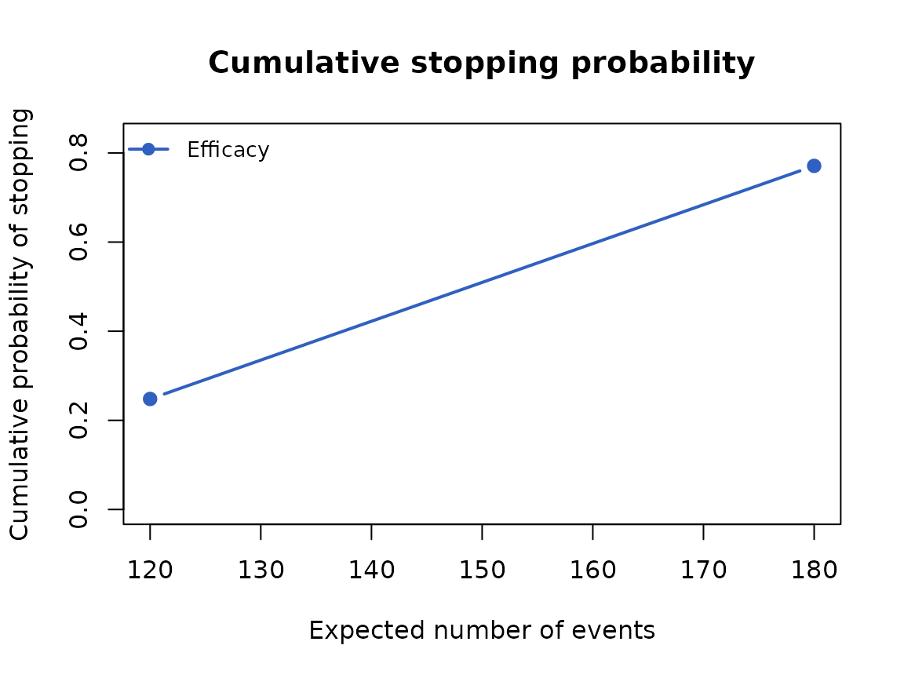
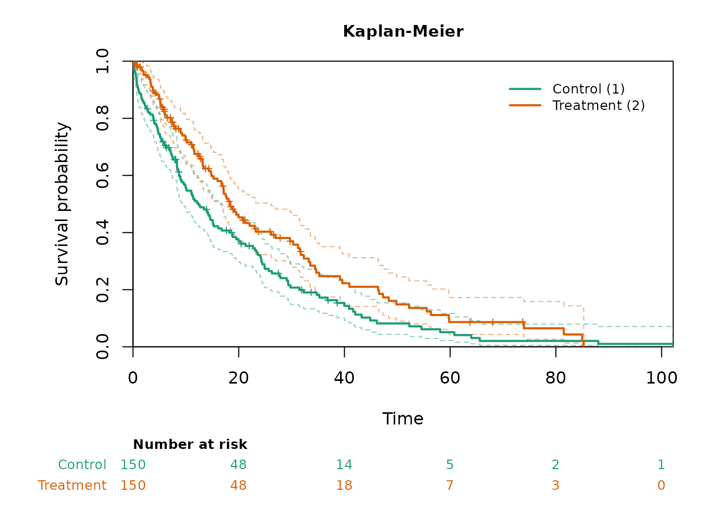

# Simulation studies with the native pipe

``` r

library(FastSurvival)
```

## Overview

A simulation study of a time-to-event trial has three steps: generate
the trials, analyze each of them at its looks, and summarize the
operating characteristics over the trials. In FastSurvival these steps
are
[`simdata_fast()`](https://gosukehommaEX.github.io/FastSurvival/reference/simdata_fast.md),
[`analysis_fast()`](https://gosukehommaEX.github.io/FastSurvival/reference/analysis_fast.md),
and
[`simsummary_fast()`](https://gosukehommaEX.github.io/FastSurvival/reference/simsummary_fast.md),
the simulation trio, and each of them takes the result of the previous
step as its first argument. A study can therefore be written as one
chain with the native pipe `|>` of R, read from top to bottom in the
order of the steps.
[`cutoff_fast()`](https://gosukehommaEX.github.io/FastSurvival/reference/cutoff_fast.md),
[`switch_fast()`](https://gosukehommaEX.github.io/FastSurvival/reference/switch_fast.md),
and
[`pairwise_fast()`](https://gosukehommaEX.github.io/FastSurvival/reference/pairwise_fast.md)
fit into the same chain.

The pipe changes only how the calls are written: `x |> f(y)` is the call
`f(x, y)`, so a chain gives the same results as nested calls or calls
with intermediate objects, and the tests of the package check this for
every function. The code below uses only syntax of R 4.1, the version
that the package requires: the pipe `|>`, functions written as
`function(x)` or in the short form `\(x)`, and no placeholder `_`, which
needs R 4.2 and is not needed here because the data always go to the
first argument.

## One chain from data to operating characteristics

The trial randomizes 150 patients per group over 12 months. The median
time to event is 12 months in the control group (group 1) and 18 months
in the experimental group (group 2), and 1 percent of the patients per
month drop out. The log-rank test is performed at 120 and 180 events,
one-sided, with the nominal levels 0.003 and 0.024 at the two looks.
These levels are only for illustration; the vignette *Group sequential
design with the simulation trio* obtains such levels from a spending
function with gsDesign.

``` r

oc <- simdata_fast(nsim = 1000, n = c(150, 150), a.time = c(0, 12),
                   a.rate = 300 / 12, e.median = list(12, 18),
                   d.hazard = 0.01, seed = 1) |>
  analysis_fast(control = 1, event.looks = c(120, 180), side = 1) |>
  simsummary_fast(p.col = "logrank.p", alpha = c(0.003, 0.024))
oc
#> Group-Sequential Operating Characteristics (simsummary_fast)
#>   Simulations: 1000
#>   Boundaries: nominal p-value on 'logrank.p'
#> 
#> Stopping Boundaries: Look by Look
#>  Look Info. Frac. Events (s) Sample (n) Nominal p Cum. Cross. Eff.
#>     1        0.67      120.0      300.0    0.0030           0.2480
#>     2        1.00      180.0      300.0    0.0240           0.7710
#> 
#> Events, Sample Size, Dropouts, Pipeline and Analysis Times: Look by Look
#>  Look Info. Frac. Sample (n) Events (s) Dropouts (d) Pipeline Analysis Time
#>     1        0.67      300.0      120.0         25.3    154.7         17.85
#>     2        1.00      300.0      180.0         38.2     81.8         29.13
#>  Cross. Eff.
#>       0.2480
#>       0.5230
#> 
#> Overall
#>   Rejection rate (efficacy):      0.7710
#>   Expected events at stop:        165.1
#>   Expected sample size at stop:   300.0
#>   Expected analysis time at stop: 26.31
```

The probability of rejecting the null hypothesis at one of the looks,
the power, is 0.771. The summary is given a name so that it can be
printed, plotted, and quoted; the
[`plot()`](https://rdrr.io/r/graphics/plot.default.html) method
continues the chain and draws the cumulative probability of stopping for
efficacy against the expected number of events.

``` r

oc |> plot(xaxis = "events")
```



## Looks from event and calendar-time rules

The looks of a trial are often defined by a combination of rules, such
as a number of events or a calendar time, whichever comes first.
[`cutoff_fast()`](https://gosukehommaEX.github.io/FastSurvival/reference/cutoff_fast.md)
computes the calendar time of each look in every simulated trial from
such rules, and
[`analysis_fast()`](https://gosukehommaEX.github.io/FastSurvival/reference/analysis_fast.md)
accepts a function of the data in `cutoff.looks`, which it applies to
the data it receives. The rule is then written inside the chain. Here
the interim analysis is at 120 events or at month 18, and the final
analysis at 180 events or at month 30, whichever comes first.

The data are generated with the same arguments and seed as in the
previous section, so they are the same data. They are given a name,
`sims`, because the following sections analyze them in several ways.

``` r

sims <- simdata_fast(nsim = 1000, n = c(150, 150), a.time = c(0, 12),
                     a.rate = 300 / 12, e.median = list(12, 18),
                     d.hazard = 0.01, seed = 1)

oc_rule <- sims |>
  analysis_fast(control = 1, side = 1,
                cutoff.looks = \(x) cutoff_fast(x, event.looks = c(120, 180),
                                                max.time = c(18, 30))) |>
  simsummary_fast(p.col = "logrank.p", alpha = c(0.003, 0.024))
oc_rule
#> Group-Sequential Operating Characteristics (simsummary_fast)
#>   Simulations: 1000
#>   Boundaries: nominal p-value on 'logrank.p'
#> 
#> Stopping Boundaries: Look by Look
#>  Look Info. Frac. Events (s) Sample (n) Nominal p Cum. Cross. Eff.
#>     1        0.66      117.1      300.0    0.0030           0.2340
#>     2        1.00      178.0      300.0    0.0240           0.7690
#> 
#> Events, Sample Size, Dropouts, Pipeline and Analysis Times: Look by Look
#>  Look Info. Frac. Sample (n) Events (s) Dropouts (d) Pipeline Analysis Time
#>     1        0.66      300.0      117.1         24.7    158.2         17.46
#>     2        1.00      300.0      178.0         37.8     84.1         28.60
#>  Cross. Eff.
#>       0.2340
#>       0.5350
#> 
#> Overall
#>   Rejection rate (efficacy):      0.7690
#>   Expected events at stop:        163.8
#>   Expected sample size at stop:   300.0
#>   Expected analysis time at stop: 25.97
```

With the calendar limits the power is 0.769 and the mean calendar time
of the final analysis is 28.6 months; with the event targets alone they
are 0.771 and 29.1 months.

## Several statistics from one analysis

When the same analysis is summarized in several ways, the analysis is
done once and its result is given a name; each summary then starts from
it with the pipe. Here the log-rank test and the restricted mean
survival time (RMST) up to month 12 are computed at the same looks and
summarized with the same nominal levels.

``` r

res <- sims |>
  analysis_fast(control = 1, event.looks = c(120, 180), side = 1,
                stat = c("logrank", "rmst"), tau = 12)

oc_lr   <- res |> simsummary_fast(p.col = "logrank.p",
                                  alpha = c(0.003, 0.024))
oc_rmst <- res |> simsummary_fast(p.col = "rmst.p", alpha = c(0.003, 0.024))

c(log_rank = oc_lr$cum.reject[oc_lr$look == "overall"],
  RMST     = oc_rmst$cum.reject[oc_rmst$look == "overall"])
#> log_rank     RMST 
#>    0.771    0.534
```

The log-rank result is that of the first section, because the data and
the looks are the same:

``` r

all.equal(oc_lr$cum.reject, oc$cum.reject)
#> [1] TRUE
```

## One simulated trial

The estimation and testing functions take a data frame piped into their
formula interface. Below, the first simulated trial is taken from `sims`
with its whole follow-up, that is, without the administrative censoring
of an analysis, and analyzed with the Cox model and with the
Kaplan-Meier curves. The control group is the first level of `group`.

``` r

one <- sims |> subset(sim == 1)

one |> coxph_fast(Surv(tte, event) ~ group, side = 1) |> as.data.frame()
#>   term   estimate std.error   conf.low   conf.high statistic     p.value
#> 1 coef -0.3463223 0.1321666 -0.6053641 -0.08728047 -2.620346 0.004392029

one |> kmcurve_fast(Surv(tte, event) ~ group) |> plot(risk_table = TRUE)
```



Inside a simulation loop, the vector interface of these functions, with
presorted data, remains the faster choice (see the vignette *Speed
comparison*).

## Illness-death data and treatment switching

The design of the vignette *Treatment switching and crossover after an
interim analysis* is written here as chains. The trial randomizes 300
patients per group over 18 months, progression-free survival (PFS) and
overall survival (OS) follow an illness-death model, PFS is analyzed at
380 PFS events, and OS at 350 deaths. In the data of
[`simdata_fast()`](https://gosukehommaEX.github.io/FastSurvival/reference/simdata_fast.md)
PFS is in the columns `e1_tte` and `e1_event` and OS in `e2_tte` and
`e2_event`;
[`cutoff_fast()`](https://gosukehommaEX.github.io/FastSurvival/reference/cutoff_fast.md)
and
[`analysis_fast()`](https://gosukehommaEX.github.io/FastSurvival/reference/analysis_fast.md)
select them with `tte.col` and `event.col`. The two cutoff rules are
written once as functions, because they are used several times.

``` r

pfs_cut <- \(x) cutoff_fast(x, event.looks = 380, tte.col = "e1_tte",
                            event.col = "e1_event")
os_cut  <- \(x) cutoff_fast(x, event.looks = 350, tte.col = "e2_tte",
                            event.col = "e2_event")

ids <- simdata_fast(nsim = 1000, n = c(300, 300), a.time = c(0, 18),
                    a.rate = 600 / 18, h01.median = list(8, 12),
                    h02.median = list(30, 36), h12.median = list(12, 12),
                    d.hazard = -log(1 - 0.05) / 12, seed = 20261007)
```

In the first scenario, crossover opens at the PFS analysis of every
trial: the control patients who are alive and on study switch at
progression, but not before the PFS analysis, and their remaining
survival time is multiplied by 1.3.
[`switch_fast()`](https://gosukehommaEX.github.io/FastSurvival/reference/switch_fast.md)
applies the function `pfs_cut` to the data it receives, and
[`analysis_fast()`](https://gosukehommaEX.github.io/FastSurvival/reference/analysis_fast.md)
applies `os_cut` to the switched data, so the OS analysis is triggered
by the deaths after switching.

``` r

ids |>
  switch_fast(group = 1, when = "later", cutoff = pfs_cut,
              aft.factor = 1.3) |>
  analysis_fast(control = 1, side = 1, cutoff.looks = os_cut,
                tte.col = "e2_tte", event.col = "e2_event") |>
  simsummary_fast(p.col = "logrank.p", alpha = 0.025)
#> Group-Sequential Operating Characteristics (simsummary_fast)
#>   Simulations: 1000
#>   Boundaries: nominal p-value on 'logrank.p'
#> 
#> Stopping Boundaries: Look by Look
#>  Look Info. Frac. Events (s) Sample (n) Nominal p Cum. Cross. Eff.
#>     1        1.00      350.0      600.0    0.0250           0.1340
#> 
#> Events, Sample Size, Dropouts, Pipeline and Analysis Times: Look by Look
#>  Look Info. Frac. Sample (n) Events (s) Dropouts (d) Pipeline Analysis Time
#>     1        1.00      600.0      350.0         42.8    207.2         35.71
#>  Cross. Eff.
#>       0.1340
#> 
#> Overall
#>   Rejection rate (efficacy):      0.1340
#>   Expected events at stop:        350.0
#>   Expected sample size at stop:   600.0
#>   Expected analysis time at stop: 35.71
```

In the second scenario, crossover opens only in the trials with a
significant PFS result. The decision needs the PFS analysis of the same
data, so the chain starts from the named data `ids` twice: once for the
PFS analysis, and once for the switch and the OS analysis, with the same
rule `pfs_cut`.

``` r

pfs <- ids |>
  analysis_fast(control = 1, side = 1, cutoff.looks = pfs_cut,
                tte.col = "e1_tte", event.col = "e1_event")
pfs_pos <- (pfs$reached & pfs$logrank.p <= 0.025) %in% TRUE

ids |>
  switch_fast(group = 1, when = "later", cutoff = pfs_cut, sims = pfs_pos,
              aft.factor = 1.3) |>
  analysis_fast(control = 1, side = 1, cutoff.looks = os_cut,
                tte.col = "e2_tte", event.col = "e2_event") |>
  simsummary_fast(p.col = "logrank.p", alpha = 0.025)
#> Group-Sequential Operating Characteristics (simsummary_fast)
#>   Simulations: 1000
#>   Boundaries: nominal p-value on 'logrank.p'
#> 
#> Stopping Boundaries: Look by Look
#>  Look Info. Frac. Events (s) Sample (n) Nominal p Cum. Cross. Eff.
#>     1        1.00      350.0      600.0    0.0250           0.1410
#> 
#> Events, Sample Size, Dropouts, Pipeline and Analysis Times: Look by Look
#>  Look Info. Frac. Sample (n) Events (s) Dropouts (d) Pipeline Analysis Time
#>     1        1.00      600.0      350.0         42.7    207.3         35.64
#>  Cross. Eff.
#>       0.1410
#> 
#> Overall
#>   Rejection rate (efficacy):      0.1410
#>   Expected events at stop:        350.0
#>   Expected sample size at stop:   600.0
#>   Expected analysis time at stop: 35.64
```

Switching rules that belong to the data-generating process are given to
[`simdata_fast()`](https://gosukehommaEX.github.io/FastSurvival/reference/simdata_fast.md)
itself, and the chain then has no switching step. Here 30 percent of the
control patients switch at progression, after which their median
survival is 18 months instead of 12.

``` r

simdata_fast(nsim = 1000, n = c(300, 300), a.time = c(0, 18),
             a.rate = 600 / 18, h01.median = list(8, 12),
             h02.median = list(30, 36), h12.median = list(12, 12),
             switch.prop = list(0.3, 0), h12.switch.median = 18,
             d.hazard = -log(1 - 0.05) / 12, seed = 20261007) |>
  analysis_fast(control = 1, side = 1, cutoff.looks = os_cut,
                tte.col = "e2_tte", event.col = "e2_event") |>
  simsummary_fast(p.col = "logrank.p", alpha = 0.025)
#> Group-Sequential Operating Characteristics (simsummary_fast)
#>   Simulations: 1000
#>   Boundaries: nominal p-value on 'logrank.p'
#> 
#> Stopping Boundaries: Look by Look
#>  Look Info. Frac. Events (s) Sample (n) Nominal p Cum. Cross. Eff.
#>     1        1.00      350.0      600.0    0.0250           0.1670
#> 
#> Events, Sample Size, Dropouts, Pipeline and Analysis Times: Look by Look
#>  Look Info. Frac. Sample (n) Events (s) Dropouts (d) Pipeline Analysis Time
#>     1        1.00      600.0      350.0         42.5    207.5         35.28
#>  Cross. Eff.
#>       0.1670
#> 
#> Overall
#>   Rejection rate (efficacy):      0.1670
#>   Expected events at stop:        350.0
#>   Expected sample size at stop:   600.0
#>   Expected analysis time at stop: 35.28
```

## Multi-arm trials

[`pairwise_fast()`](https://gosukehommaEX.github.io/FastSurvival/reference/pairwise_fast.md)
takes the place of
[`analysis_fast()`](https://gosukehommaEX.github.io/FastSurvival/reference/analysis_fast.md)
in a trial with several experimental arms and a shared control. Here
three arms of 150 patients have median survival times of 12 (control),
16, and 20 months; the 200th event of the control and the third arm
fixes the cutoff of both comparisons, and the Bonferroni-adjusted
p-values are compared with the one-sided level 0.025.
[`simsummary_fast()`](https://gosukehommaEX.github.io/FastSurvival/reference/simsummary_fast.md)
summarizes each arm separately.

``` r

simdata_fast(nsim = 1000, n = c(150, 150, 150), a.time = c(0, 12),
             a.rate = 450 / 12, e.median = list(12, 16, 20), seed = 2) |>
  pairwise_fast(control = 1, event.looks = 200, primary = 3, side = 1,
                adjust = "bonferroni") |>
  simsummary_fast(p.col = "p.adj", alpha = 0.025)
#> Group-Sequential Operating Characteristics (simsummary_fast)
#>   Simulations: 1000
#>   Boundaries: nominal p-value on 'p.adj'
#> 
#> Arm: 2
#> Stopping Boundaries: Look by Look
#>  Look Info. Frac. Events (s) Sample (n) Nominal p Cum. Cross. Eff.
#>     1        1.00      211.6      300.0    0.0250           0.4450
#> 
#> Events, Sample Size, Dropouts, Pipeline and Analysis Times: Look by Look
#>  Look Info. Frac. Sample (n) Events (s) Dropouts (d) Pipeline Analysis Time
#>     1        1.00      300.0      211.6          0.0     88.5         30.76
#>  Cross. Eff.
#>       0.4450
#> 
#> Overall
#>   Rejection rate (efficacy):      0.4450
#>   Expected events at stop:        211.6
#>   Expected sample size at stop:   300.0
#>   Expected analysis time at stop: 30.76
#> 
#> Arm: 3
#> Stopping Boundaries: Look by Look
#>  Look Info. Frac. Events (s) Sample (n) Nominal p Cum. Cross. Eff.
#>     1        1.00      200.0      300.0    0.0250           0.9150
#> 
#> Events, Sample Size, Dropouts, Pipeline and Analysis Times: Look by Look
#>  Look Info. Frac. Sample (n) Events (s) Dropouts (d) Pipeline Analysis Time
#>     1        1.00      300.0      200.0          0.0    100.0         30.76
#>  Cross. Eff.
#>       0.9150
#> 
#> Overall
#>   Rejection rate (efficacy):      0.9150
#>   Expected events at stop:        200.0
#>   Expected sample size at stop:   300.0
#>   Expected analysis time at stop: 30.76
```

## Large studies in batches

The data of all simulated trials are held in memory at once, so a large
study is run in batches. Each batch below is one chain from the data to
the analysis results; the batches use the same seed and their own
random-number streams (`stream = b`), so the data of a batch do not
depend on the other batches or on the order in which the batches are
run. The simulated trials are numbered from 1 in every batch and are
renumbered before the results are combined and summarized. With
[`parallel::mclapply()`](https://rdrr.io/r/parallel/mclapply.html) or
the future framework in place of
[`lapply()`](https://rdrr.io/r/base/lapply.html), the batches run in
parallel and give the same results.

``` r

run_batch <- function(b, nsim = 250) {
  res_b <- simdata_fast(nsim = nsim, n = c(150, 150), a.time = c(0, 12),
                        a.rate = 300 / 12, e.median = list(12, 18),
                        d.hazard = 0.01, seed = 2026, stream = b) |>
    analysis_fast(control = 1, event.looks = c(120, 180), side = 1)
  res_b$sim <- res_b$sim + (b - 1) * nsim
  res_b
}

oc_batch <- do.call(rbind, lapply(1:4, run_batch)) |>
  simsummary_fast(p.col = "logrank.p", alpha = c(0.003, 0.024))
oc_batch
#> Group-Sequential Operating Characteristics (simsummary_fast)
#>   Simulations: 1000
#>   Boundaries: nominal p-value on 'logrank.p'
#> 
#> Stopping Boundaries: Look by Look
#>  Look Info. Frac. Events (s) Sample (n) Nominal p Cum. Cross. Eff.
#>     1        0.67      120.0      300.0    0.0030           0.2920
#>     2        1.00      180.0      300.0    0.0240           0.7620
#> 
#> Events, Sample Size, Dropouts, Pipeline and Analysis Times: Look by Look
#>  Look Info. Frac. Sample (n) Events (s) Dropouts (d) Pipeline Analysis Time
#>     1        0.67      300.0      120.0         25.0    155.0         17.80
#>     2        1.00      300.0      180.0         37.9     82.1         29.05
#>  Cross. Eff.
#>       0.2920
#>       0.4700
#> 
#> Overall
#>   Rejection rate (efficacy):      0.7620
#>   Expected events at stop:        162.5
#>   Expected sample size at stop:   300.0
#>   Expected analysis time at stop: 25.74
```

The 1000 trials of the four batches give a power of 0.762, which differs
from the value of the first section only by Monte Carlo error, because
the batches are drawn from other random-number streams. The max-combo
p-values of
[`analysis_fast()`](https://gosukehommaEX.github.io/FastSurvival/reference/analysis_fast.md)
with four or more weights, or with a two-sided test, use R’s own
random-number generator; for p-values that are identical across runs,
each batch then also calls
[`set.seed()`](https://rdrr.io/r/base/Random.html) before the analysis.

## Remarks

The examples above follow a few rules. Each function of the chain
receives the data, or the result of the previous step, as its first
argument, so the placeholder `_` of R 4.2 is never needed, and the code
runs with R 4.1. An intermediate result is given a name when it is used
more than once, as the data `sims` and `ids` and the analysis results
`res` and `pfs` above; a chain then starts from the name. Rules that
depend on the data, such as the cutoffs of
[`cutoff_fast()`](https://gosukehommaEX.github.io/FastSurvival/reference/cutoff_fast.md),
are passed as functions, so that they are applied to the data at that
point of the chain.
